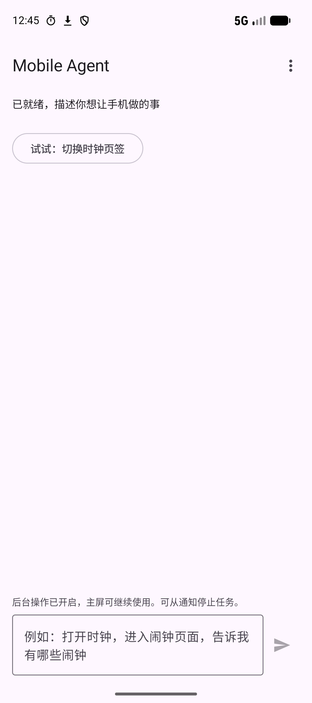
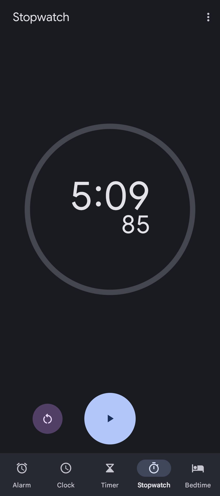

<div align="center">

# Mobile Agent Runtime

**一句话，让安卓手机完成任务。**

直接运行在安卓手机上的开源 Agent。描述目标，它会读取页面并操作 App。

[English](README.md) · [简体中文](README.zh-CN.md)


[](LICENSE)

</div>

告诉手机你想完成什么。Agent 会打开应用，读取页面，选择下一步动作。
每次操作后，它都会重新观察页面，并在当前对话里返回结果。

Agent 在手机内运行。模型推理使用你配置的 API 服务和密钥。
开启 Shizuku 后，目标 App 可以在独立显示屏中运行，主屏可以继续使用。

> **Alpha 阶段：** 已在模拟器上跑通时钟、系统设置和应用安装。真机兼容性、登录和验证码接管仍在开发中。

## 看它怎么用

<p align="center">
  
  &nbsp;&nbsp;
  
</p>

<p align="center">应用界面 · 独立显示屏中的时钟</p>

可以先试这些任务：

```text
打开时钟，启动秒表，再暂停，告诉我经过了多长时间。

打开系统设置，搜索 bluetooth，读取前三条结果，再返回设置首页。

从我提供的发行方地址下载官方微信 APK 并安装，不要登录。
```

这些任务使用同一套工具。运行时没有为每个 App 单独编写固定点击脚本。
时钟任务完成了秒表启动和暂停。设置任务完成了搜索输入和返回。
安装任务下载了官方微信 APK，并安装了 8.0.79 版本。

## 可以做什么

- **按目标操作 App。** 打开应用、选择控件、输入文字、滚动页面、返回上一页。
- **读取页面。** 结合界面控件和截图，查看当前 App 的内容与状态。
- **让主屏保持可用。** 通过 Shizuku，让目标 App 在独立显示屏中运行。
- **下载和安装应用。** 下载 APK、查询进度、校验包名，再通过 Shizuku 安装。
- **使用自己的模型服务。** 支持提供 Chat Completions 和工具调用的 OpenAI-compatible HTTPS 服务。
- **随时停止。** 在应用内或任务通知中点击“停止”。

能否完成任务，取决于目标 App 提供的界面控件。
页面不可读、权限不足或账号受限时，任务可能停止。

## 快速开始

### 1. 准备环境

| 项目 | 要求 |
|---|---|
| 手机或模拟器 | 前台模式需要 Android 11 或更新版本 |
| 后台模式 | Android 14 或更新版本，并启动和授权 Shizuku |
| Node.js | 22 或更新版本 |
| Java | JDK 17 或更新版本 |
| Android SDK | API 37 平台和 37.0.0 构建工具 |
| 模型服务 | 支持工具调用的 HTTPS Chat Completions API |

安装 [Android Studio](https://developer.android.com/studio)。
在 SDK Manager 中安装所需的平台、构建工具和 platform-tools。
将 `ANDROID_HOME` 设为 SDK 所在目录。
将 SDK 的 `platform-tools` 目录加入 `PATH`。

macOS 上的 Android Studio 通常使用以下路径：

```bash
export ANDROID_HOME="$HOME/Library/Android/sdk"
export JAVA_HOME="/Applications/Android Studio.app/Contents/jbr/Contents/Home"
export PATH="$ANDROID_HOME/platform-tools:$ANDROID_HOME/emulator:$PATH"
```

其他系统请使用实际的 SDK 和 Java 安装路径。

### 2. 构建应用

```bash
git clone https://github.com/Hui-cd/mobile-agent-runtime.git
cd mobile-agent-runtime
npm ci
npm run android:build
```

构建完成后，APK 位于：

```text
apps/android/app/build/outputs/apk/debug/app-debug.apk
```

### 3. 安装应用

使用真机时，在开发者选项中开启 USB 调试。
将手机连接到电脑。
在手机上允许 USB 调试请求。

使用模拟器时，在 Android Studio Device Manager 中创建虚拟设备。
先启动虚拟设备，再安装 APK。

```bash
adb devices
adb install -r apps/android/app/build/outputs/apk/debug/app-debug.apk
```

如果 ADB 列出多个设备，使用 `adb -s <serial> install -r <apk-path>` 指定安装目标。

### 4. 配置并运行

1. 打开 **Mobile Agent**。
2. 填写模型 API Key。
3. 保存模型设置。
4. 在 Android 无障碍设置中启用 **Mobile Agent device control**。
5. 允许 Mobile Agent 发送通知。
6. 保持屏幕点亮，并解锁设备。
7. 输入上面的示例任务。

默认模型服务是 Kimi：

| 配置项 | 默认值 |
|---|---|
| Base URL | `https://api.moonshot.cn/v1` |
| 模型 | `kimi-k3` |

需要更换服务时，在高级模型设置中修改 Base URL 和模型名称。
应用通过 Android Keystore 加密保存 API Key。
模型请求会将任务内容、页面文字和请求的截图发送给你选择的模型服务。

未开启后台模式时，Agent 会将目标 App 切到主屏。
操作期间，可以从通知停止任务。

## 开启后台操作

后台模式会将目标 App 放到独立的 Android 显示屏中。
Agent 读取并操作这个显示屏。你可以在主屏使用其他 App。

1. 安装 [Shizuku](https://shizuku.rikka.app/download/)。
2. 按照 [Shizuku 启动指南](https://shizuku.rikka.app/guide/setup/)启动服务。
3. 打开 Mobile Agent。
4. 打开应用菜单。
5. 选择 **开启后台执行（Shizuku）**。
6. 允许 Mobile Agent 使用 Shizuku。
7. 首次授权后，再次选择后台执行选项。
8. 输入任务。

菜单会显示当前模式。
任务输入框上方也会显示后台模式提示。
需要恢复前台操作时，在菜单中选择 **后台执行已开启 · 切回主屏**。

任务操作在设备内执行。Shizuku 启动后，不需要电脑控制进程持续运行。
本次模拟器验证通过 ADB 启动了 Shizuku。手机内无线启动仍需实际设备验证。

使用时保持亮屏和解锁。
不要同时在主屏操作 Agent 正在使用的同一个 App。
部分 App 或系统弹窗仍可能跳到主屏。
设备重启后，如果 Shizuku 已停止，需要重新启动服务。

## 下载和安装 App

向 Agent 提供发行方的 APK 地址和预期包名。
例如，微信的包名是 `com.tencent.mm`。

Agent 可以下载文件并查询进度。
安装前，它会将 APK 包名与预期包名进行比较。
安装需要开启后台模式，并完成 Shizuku 授权。

下载完成不代表安装完成。
只有系统完成安装并能读取到对应包名后，运行时才返回安装成功。
当前会校验包名，但没有额外的发行方签名鉴定流程。

Google Play 可能要求登录 Google 账号。
当前版本还没有登录和验证码接管功能。

## 通过飞书、微信控制

目标使用方式是：在聊天里发送任务，手机完成操作，再把结果返回原来的聊天。

| 入口 | 当前支持 |
|---|---|
| Mobile Agent 应用 | 在设备内发送 App 任务并查看结果 |
| 飞书机器人 | 开发版入口，支持时钟、状态和停止命令 |
| 微信聊天 | 计划中 |

飞书开发入口运行在电脑上，通过 ADB 将任务发送给模拟器。
它还没有实现独立的手机通讯链路。
飞书线上收发仍需使用实际账号验证。

准备开发版机器人：

1. 创建飞书应用，并启用机器人。
2. 开通接收私聊消息和发送机器人消息的权限。
3. 为事件接收选择长连接方式。
4. 订阅 `im.message.receive_v1`。
5. 将应用发布给允许使用的用户。

开发时，将 `.env.feishu.example` 复制为 `.env.feishu`。
填写机器人凭据和允许控制设备的用户 ID。
然后启动入口：

```bash
npm run channel:feishu:dev
```

支持的聊天命令是 `/clock`、`/status` 和 `/stop`。
该入口暂不接受任意 App 任务。
安装微信并不代表已经支持通过微信聊天控制手机。

## 没有安卓手机？

可以先用模拟器。
在 Android Studio Device Manager 中创建 Android 17 虚拟设备，即可与当前验证环境保持一致。
Android 14 或更新版本的模拟器可以尝试后台模式，但兼容性可能不同。

在 Device Manager 中启动虚拟设备。
也可以通过终端列出并启动设备：

```bash
emulator -list-avds
emulator -avd <avd-name> -no-snapshot-save
```

按照快速开始的步骤安装 APK。
在模拟器内配置模型，并开启所需权限。
模拟器中的 App 和账号需要单独安装与配置。
它不会自动拥有你手机上的应用和登录状态。

## 工作方式

```text
你的目标
   ↓
手机内 Agent ↔ 你配置的模型服务
   ↓
观察页面 → 选择动作 → 操作应用 → 再次观察
   ↓
返回结果，或说明需要你处理的问题
```

运行时向模型提供三个工具：

| 工具 | 用途 |
|---|---|
| `device_observe` | 读取当前 App、界面控件和请求的截图 |
| `device_invoke` | 打开应用或链接、调用系统能力、下载和安装 APK |
| `device_act` | 选择控件、输入文字、滚动、滑动或返回 |

Android Intent 用于打开应用和系统页面。
Accessibility 用于读取控件和操作界面。
后台模式通过 Shizuku 创建独立显示屏，并提供所需的特权操作。

不同 App 复用同一套工具接口，无需为每个 App 增加模型工具。
新增 App 流程仍需在对应应用中实际验证。

## 开发

在仓库根目录运行：

```bash
npm test
npm run build
npm run android:test
npm run android:build
```

当前检查包含 56 项 Node 测试和 52 项 Android 单元测试。
编译和单元测试不能证明所有手机或 App 都兼容。
真机、登录接管、熄屏执行和长任务仍需进一步验证。

后续重点是登录与验证码接管、独立通讯入口和真机兼容性。

## 常见问题

| 问题 | 处理方法 |
|---|---|
| 构建找不到 SDK | 将 `ANDROID_HOME` 设为 Android SDK 所在目录。 |
| ADB 显示 `unauthorized` | 在手机上允许 USB 调试请求。 |
| 应用无法操作控件 | 在无障碍设置中启用 Mobile Agent。 |
| 后台模式无法启动 | 启动 Shizuku，并授权 Mobile Agent。 |
| 熄屏后任务停止 | 点亮屏幕。解锁设备。重新发起任务。 |
| 目标 App 要求登录或验证码 | 停止任务。先自行完成账号步骤。 |
| 依赖下载较慢 | 尝试下面的可选构建镜像。 |

```bash
MOBILE_AGENT_USE_HUAWEI_MIRROR=1 npm run android:build
```

## 参与项目

通过 [GitHub Issues](https://github.com/Hui-cd/mobile-agent-runtime/issues) 提交可复现的问题。
请说明 Android 版本、App 版本、任务和实际结果。
代码贡献流程见 [CONTRIBUTING.md](CONTRIBUTING.md)。
安全问题报告方式见 [SECURITY.md](SECURITY.md)。

## 许可证

Mobile Agent Runtime 使用 [Apache License 2.0](LICENSE)。
第三方组件保留各自的许可证。
