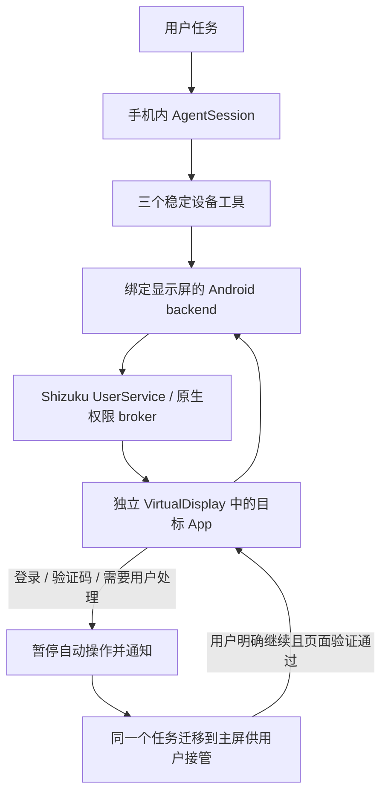

# Android 隐藏执行：机制调研与模拟器实验

> 本文保留接入前的机制调研与外部 shell 实验。2026-10-12 已完成手机内 Shizuku 集成，当前实现和证据见 [后台执行设计](../../docs/android-hidden-execution-design.md)。下文的未集成结论描述的是当时实验状态。


调研跨 2026-10-11 / 2026-10-12。结论：在额外授权条件下，独立显示屏上的 App 渲染与操作可行；应优先实现 Shizuku UserService + trusted VirtualDisplay 的手机内原型。普通 APK 的无障碍权限或前台服务，不能单独授予创建 trusted display 的权限。

本目录为独立研究，未接入产品 backend。实验是桌面 ADB + scrcpy server 驱动 Android 17 模拟器，不是真机、不是手机 Agent 隐藏执行，也未验证手机内 Shizuku 激活。

## 目标架构



- REUSE：Pi loop、三个工具、节点选择器、原生审批、通知/停止、运行账本。
- EXTEND：观察、截图、手势、输入、返回和应用启动全部绑定同一 display/session；观察 ID 在迁移后失效。
- ADD：手机内授权 broker、虚拟显示会话和登录/验证码交接状态。
- REPLACE：隐藏 backend 中依赖 rootInActiveWindow、DEFAULT_DISPLAY、主屏 displayMetrics 或未指定显示屏的全局动作。

显示 ID 留在原生 backend 内，模型不需要学习显示管理。不能在失败时静默切回用户主屏。只有用户确认接管/继续时才迁移任务。

## 路线比较

| 路线 | 技术能力与条件 | 决定 |
|---|---|---|
| 普通无障碍 + 前台服务 | 可操作可观察的窗口，但本身不授予 trusted display 创建权限；隐藏普通窗口不会产生独立 UI | 保留前台 baseline，不将其叫隐藏执行 |
| OEM ComputerControl | 官方文档要求设备预装扩展、ASSISTANT 角色、agent/target allowlist 与逐 App 用户同意 | 长期优先的正式产品能力；本设备未发现扩展库，不能作为当前普适入口 |
| Companion app streaming / VDM | AOSP 规定相应 streaming role 仅授予预装 priv-app，拥有 CREATE_VIRTUAL_DEVICE 等能力 | 需要 OEM 路线，不能仅凭普通 APK 的 manifest 实现 |
| Shizuku + trusted VirtualDisplay | Android 11+ 可手机内无线配对启动，UserService 能运行 shell UID Java/JNI；用户须安装/授权并在重启后重新启动 | 当前最小手机内原型候选；优先验证 Android 14+ 的独立焦点行为 |
| Root / Sui | 特权与启动能力更强，但安装和设备修改成本更高 | 不作为 v0 必需条件 |
| 独立设备 / 云手机 | 可隔离 UI，但改变用户账号、相册和运行位置 | 不满足当前“自己的手机，不依赖电脑/云手机”的产品条件 |
| App 官方 API / Intent | 能覆盖对应业务时可直接后台执行，可靠且不需要模拟 UI | 作为能力优先路径，不能代替任意 App 的 GUI backend |

## 实际实验

工具固定为官方 scrcpy **v5.0.1**，macOS ARM64 release SHA256 为 `33611e51977a8289e2e124b220f727895181ef2eb9060e0987a4dc2db9cf0d6b`；已和官方 release manifest 比对。tag 对象为 `a0c27ff382c411af1301dcc1cd8205c9aeb81996`。

设备为 Pixel_9 AVD、Android 17 / API 37。shell UID=2000 的实际权限包含 ADD_TRUSTED_DISPLAY、CAPTURE_VIDEO_OUTPUT、INJECT_EVENTS。

| 实验 | 观察与判定 |
|---|---|
| 720×1280 / 240 dpi 虚拟屏启动 Clock | Clock 在 display 2，Mobile Agent 在 display 0；分别截图可区分内容 |
| 隐藏屏点击 Stopwatch | 按观察到的节点 bounds 向 display 2 注入点击；秒表实际选中；主屏内容像素无变化（忽略状态栏/导航栏） |
| 主屏同时操作 | 主屏菜单可以打开，隐藏 Clock 仍在原显示屏渲染 |
| 输入法位置 | Settings 搜索框位于 display 2；mCurDisplayId=2，输入法 UI 出现在隐藏屏，主屏没有被输入法占用。没有验证中文输入或复杂 IME 场景 |
| YouTube 隐藏渲染 | 官方 YouTube 已存在的任务可运行在虚拟屏；可见 Home / You 未登录页面 |
| 用 MAIN Intent 交接 | 能迁移任务，但重新发 MAIN Intent 会改变页面；不应用于保存登录/验证码流程 |
| 低尺寸直接迁移同一个任务 | 用 moveRootTaskToDisplay 保留 task ID，但 You 页面在迁移到不同尺寸/密度的主屏后回到 Home；失败记录保留 |
| 与主屏同尺寸 1080×2424 / 420 dpi | 同一 task 119 从 display 3 → 0 → 3，You 的未登录页面在往返后保留 |

**解释边界**：匹配尺寸/密度与这次状态保留相关，是合理的原型默认值，不足以证明所有 App 都保留状态或失效唯一原因是尺寸变化。Insets、旋转、multi-window、Activity 的配置变化处理仍需各自验证。没有实际登录或处理验证码，也没有验证熄屏、锁屏或同一个 App 在主屏与隐藏屏同时交互。

原始汇总：[mechanism-results.json](evidence/mechanism-results.json)。

关键图片：[主屏](evidence/main-after.png)、[隐藏秒表](evidence/secondary-after.png)、[隐藏输入法](evidence/secondary-ime.png)、[低尺寸交接前](evidence/youtube-login-before-move.png)、[低尺寸交接失败](evidence/youtube-login-handoff.png)、[同尺寸交接](evidence/equal-handoff.png)、[同尺寸返回](evidence/equal-return.png)。

## 如何接入现有工程

1. 使用 Shizuku 的 **UserService** 承载显示管理代码，不给模型任意 shell。授权入口、binder 存活和 caller 校验留在原生层；授权后再建立 display/session。
2. 显示创建采用已验证的 shell 服务调用方式，注意 system service 对 UID 与 packageName 的匹配检查。UserService 不是普通 Android app process，不能假设任意 Context API 都可用。
3. 初期虚拟屏尺寸与密度匹配主屏；推理图片可以缩小，不要为缩小模型图片先改变 App 的实际渲染尺寸。
4. 语义观察优先复用无障碍服务的 getWindowsOnAllDisplays，按 displayId 取窗口；截图用 takeScreenshot(displayId) 或该显示屏自己的 Surface/ImageReader。截图失败不能借用主屏图片。
5. 节点动作作用于该显示屏的真实节点；手势可用 GestureDescription.Builder.setDisplayId；BACK、HOME、IME 提交等需要明确的显示作用域。滚动坐标来自该显示屏尺寸，不使用主屏 metrics。
6. 输入法策略设为 local。同时评估同 App 单实例、系统权限弹窗、文件选择器、跨 App OAuth 是否移到主屏；这些行为必须被观察和记录，不能假定永远隔离。
7. 新增 WAITING_USER_ACTION 与 HANDING_OFF / RESUMING：暂停动作及敏感帧采集 → 保存 checkpoint → 移同一 task 到主屏 → 用户处理 → 明确继续 → 核对页面 → 移回隐藏屏并重新观察。
8. 原生操作发送前记录 operation_id / pending，结果观察后终结；进程或授权丢失时记 RUN_INTERRUPTED，不能盲目重放“上传”等可能已产生效果的动作。

授权和配置成本：Shizuku 无 root 路径需要开发者选项、无线调试配对、安装/授权；每次重启后需重新启动。早期版本如果复用无障碍，还需要无障碍授权。应把这些归入首次设置与异常修复，不要求用户每天操作命令行，也不能声称“装一个 APK 就无需任何额外设置”。

scrcpy 默认 flags 包含 ALWAYS_UNLOCKED。本实验没有测试锁屏，不将该 flag 或成熟工具全部默认行为机械继承为产品策略。FLAG_SECURE 与“登录/支付/验证码”并不等价；业务阻塞与截图保护必须分开判断。

## 增量与通过标准

1. **手机内机制**：引入 Shizuku UserService，在没有桌面 ADB/scrcpy 常驻时完成创建显示、启动 Clock、观察、一次动作、新观察、释放会话。
2. **Agent 闭环**：用同一套模型工具做 Clock / Settings 的只读任务；主屏执行另一项用户操作，输入/截图不得混屏，连续 10 次保留证据。
3. **用户交接**：真实 App 在登录/验证码时停下，敏感输入不进模型；人工处理后同一任务继续，连续三次不丢页面/不重复业务动作。
4. **可靠性**：binder 死亡、app process 被杀、旋转、省电与网络恢复；再用真机单独测试屏幕关闭/锁屏，不继承亮屏成功率。

产品完成前，支持设备/版本应基于实测名单。机制在模拟器通过不等于可承诺任意 Android、任意 App 都能隐藏控制。

## 可复现的实验入口

以下是开发实验，依赖电脑，不是产品运行命令：

```sh
scrcpy --serial=emulator-5554 --new-display --start-app=com.google.android.youtube \
  --display-ime-policy=local --no-window --no-audio --record=probe.mkv
```

`MoveRootTask.java` 是只接受 task_id/display_id 的实验 helper。用 Android SDK 的 javac/d8 生成 dex jar 后，以 shell 的 app_process 启动；不要作为普通 App 的公开接口。代码已在此 AVD 验证往返迁移，但未验证其他 Android 版本。生产 broker 还必须核对任务所有权和会话授权。

## 一手来源

- [scrcpy v5.0.1 virtual display 文档](https://github.com/Genymobile/scrcpy/blob/v5.0.1/doc/virtual-display.md)
- [scrcpy v5.0.1 NewDisplayCapture 源码](https://github.com/Genymobile/scrcpy/blob/v5.0.1/server/src/main/java/com/genymobile/scrcpy/video/NewDisplayCapture.java)
- [Shizuku API / UserService](https://github.com/RikkaApps/Shizuku-API#userservice)
- [Shizuku 手机内无线调试启动与重启要求](https://shizuku.rikka.app/guide/setup/#start-via-wireless-debugging)
- [AOSP DisplayManagerService 权限与 display flags 检查](https://android.googlesource.com/platform/frameworks/base/+/refs/heads/android16-release/services/core/java/com/android/server/display/DisplayManagerService.java)
- [Android VirtualDeviceManager / OEM ComputerControl 条件](https://developer.android.com/reference/android/companion/virtual/VirtualDeviceManager)
- [AOSP companion app streaming 的 priv-app/role 条件](https://source.android.com/docs/core/permissions/app-streaming)
- [无障碍多显示屏观察与截图](https://developer.android.com/reference/kotlin/android/accessibilityservice/AccessibilityService)
- [GestureDescription.Builder.setDisplayId](https://developer.android.com/reference/android/accessibilityservice/GestureDescription.Builder#setDisplayId(int))
